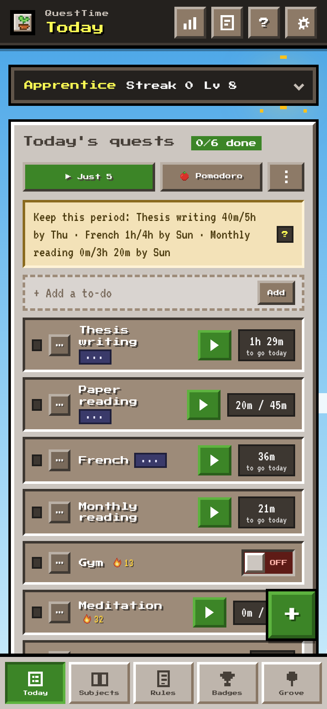
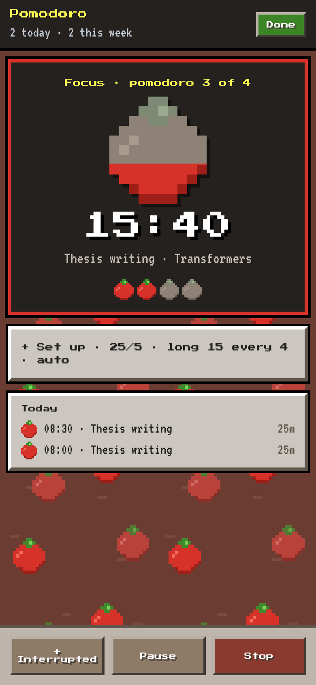
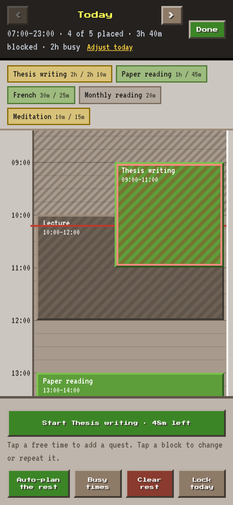
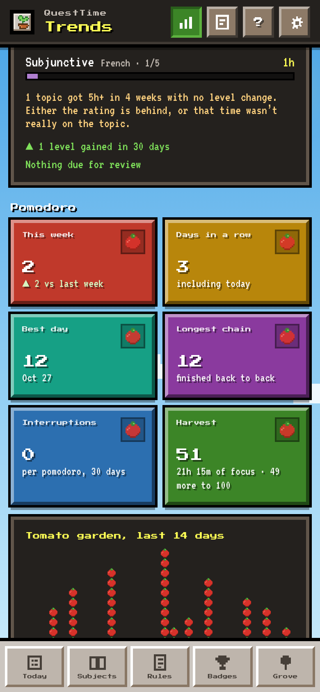
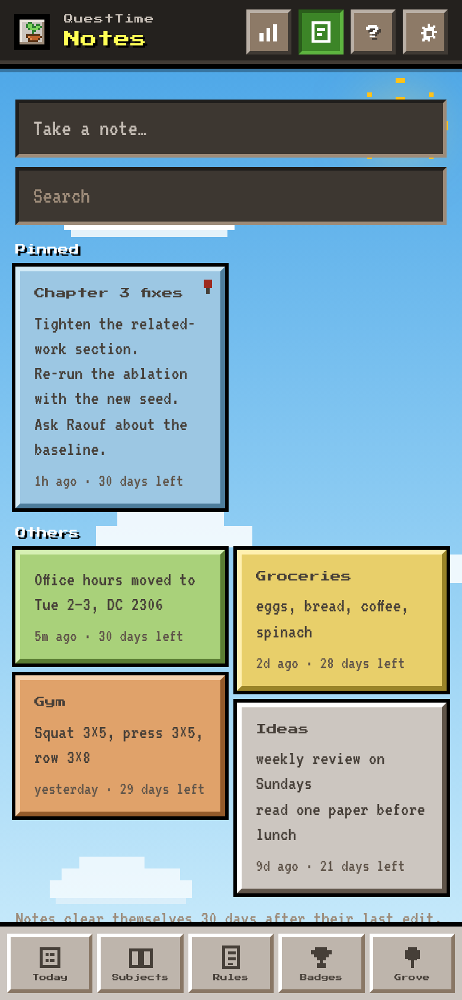
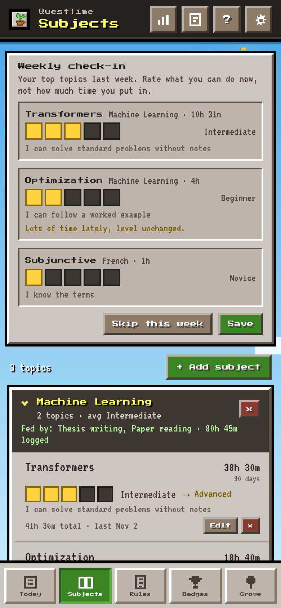
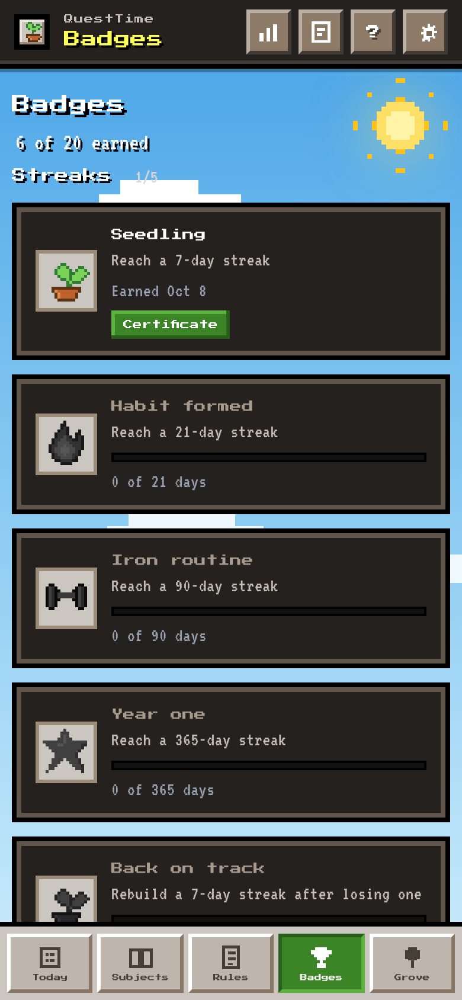
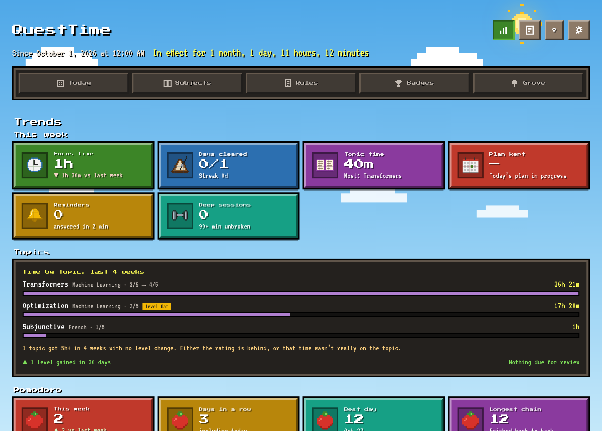
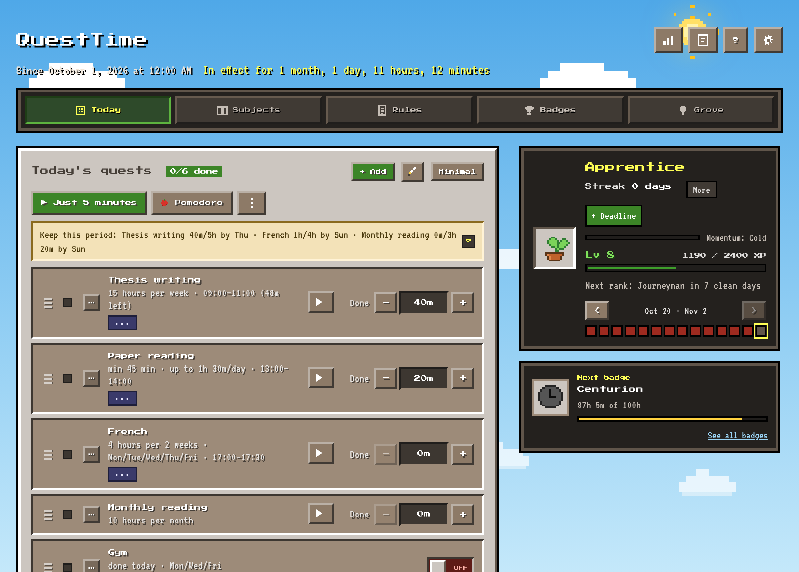

# QuestTime

A pixel-art habit game for people who need their days to have shape. You set quests — daily habits, timed work, targets, limits, weekly totals, to-dos — and the app turns each day into something you can clear, keep a streak on, plan hour by hour, and look back on. Runs as a web app (PWA) and as an Android app; your data lives on your device, with an optional account that syncs it between devices.

Live: **https://arshdeepsp.github.io/ProductivityCraft/** (the repo keeps the old name, ProductivityCraft, so existing installs carry over)

<p align="center">
  
  
  
  
</p>

## What a day looks like

**Today** is the list of quests that are on for this day. Each one has a type: a *time* quest with a minimum (and an optional daily cap), a *check*, a *target* with units, a *limit* you must stay under, a *clock-time* quest ("up by 7"), a *weekly* count, a *period total* (so many hours a week, fortnight or month, paced by your work days), or a one-off *to-do*. Clear every required quest and the day is cleared; a first miss is grace, a second resets the streak unless you've earned a freeze. Time quests have a ▶ timer that locks the screen into a single card while it runs, and a 5-minute "Just 5" start for the days you can't face the full thing.

**Challenge or Casual.** Challenge is the full game — streaks, freezes, period totals judged, badges, a grove that grows with your clean days. Casual keeps the XP and the logging but judges nothing, and lets you shelve quests on an ignore list; good for exam weeks and holidays.

**Schedule.** Tap a free hour, pick a quest, and it's a block; hold to move it, split it, repeat it weekly. Busy times (lectures, work) are a weekly template the planner works around. Auto-plan fills the rest. Blocks remind you when they start and nag you if you haven't begun; ended blocks become a record of what the plan was against what you actually did, so you can see how often you keep your own word. You can lock a day so nothing moves.

**Pomodoro.** A full-screen tomato for one of today's time quests: 25 on, a short break, a long one every fourth. Finishing logs the minutes to the quest and draws the block onto the schedule after the fact; stopping early logs nothing — the point of cutting work into pomodoros is to finish them. Lengths are locked while a set is under way, and a set can be ended early, which takes the whole set back. Auto-start carries you through the breaks and stops at the end of a set unless you ask it not to. It runs on the wall clock, so a phone that sleeps through a break still beeps, shows the next pomodoro counting down in the status bar, and has the right thing logged when you open the app.

**Subjects and topics.** Quests feed topics; topics belong to subjects. Every timer lands its minutes on a topic, and once a week you re-rate the topics you worked on most — proficiency is only ever self-rated, time never changes it. Trends flags a topic you keep pouring hours into without the rating moving.

**Notes.** A Google Keep-style page: colours, pins, search, an editor that saves as you type. Nothing on it is permanent — a note clears itself 30 days after you last touched it, and the card counts down.

**Trends, badges, grove.** Trends shows the week (focus time, days cleared, plan kept, deep sessions), time by topic, focus by hour of day, a pomodoro section (this week, days in a row, best day, longest chain, harvest, and a 14-day tomato garden), and your records. Twenty badges, each with a certificate. The grove is a pixel garden that grows with your streak.

<p align="center">
  
  
  
  
</p>

## On the phone

The Android app adds what a web page can't: a live notification with the timer ticking (a sapling grows toward your goal; a tomato fills during a pomodoro), reminders that fire with the app closed (check-ins, streak risk, schedule starts, "get back to it", deadlines, the morning promise), action buttons on the pomodoro reminders, and sounds on their own channels. The web app is the same app without those.

<p align="center"></p>

## Data

Everything is stored on the device and can be exported as a JSON backup at any time. Sign in (email and password) and the same data syncs between your devices: changes merge by content, so two phones editing different things both keep their edits, and nothing waits on a server to use the app. Sign out and the account's data leaves the device.

## Running it

```
npm install
npx playwright install chromium
npm run build
npm run serve
```

`npm run build` writes `dist/`; `npm run serve` opens it at http://localhost:8080. Pushing to `main` runs the tests and, if they pass, deploys `dist/` to GitHub Pages.

Android, first time:

```
npm run build
npx cap add android
node scripts/add-permissions.cjs
npx @capacitor/assets generate --android
npm run android:apk
```

After that `npm run android:apk` rebuilds the web app, syncs it into the Android project, adds the one native plugin (the live notification) and builds `android/app/build/outputs/apk/debug/app-debug.apk`.

## Tests

`npm test` builds the app and runs ~480 Playwright tests against the real page with a fake clock and seeded storage — day and streak rules, period totals, the schedule, pomodoros (including sleeping through a break and catching up), notes, sync between two simulated devices, backups and schema upgrades, phone layouts, and the live notification payloads. The screenshots above come out of the same machinery: `npm run shots` seeds the test fixture (a realistic account) and captures every screen, so they're always of the current build.

For how the code is organised, see `CLAUDE.md`.
